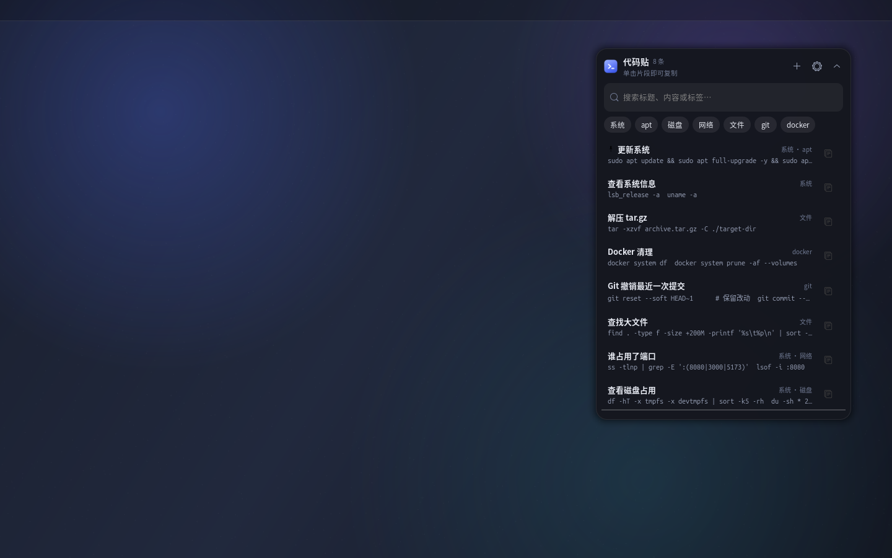
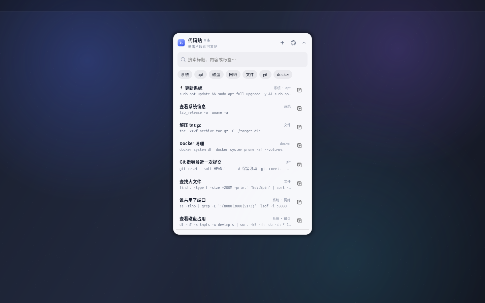
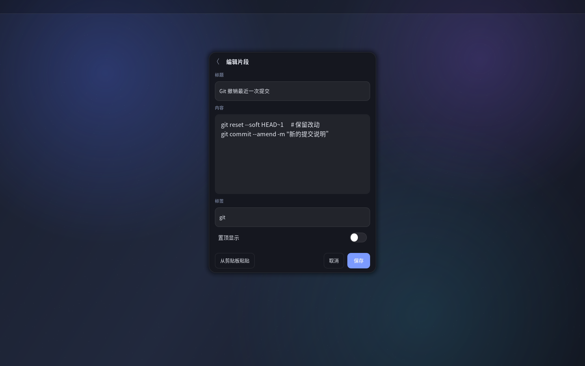

# 代码贴 CodePill

> 悬浮在桌面角落的代码 / 命令行速取工具：点开悬浮球 → 看到你存过的片段 → **单击即复制**。



<p>
  
  
</p>

仓库地址：<https://github.com/ALEforwind/code-pill>

## 功能

- **悬浮球常驻桌面**：无边框、半透明、始终置顶，可拖动，位置自动记忆。
- **一键复制**：单击任意片段立刻写入系统剪贴板，并提示「已复制」。
- **搜索与标签**：按标题、内容或标签即时过滤，标签胶囊一键筛选。
- **就地管理**：新建 / 编辑 / 删除 / 置顶，删除后 5 秒内可撤销，支持从剪贴板粘贴。
- **整行可点**：设置项点文字或点开关都能切换。
- **深色 / 浅色主题**、复制后自动收起、开机自启，均可在设置里切换。
- **本地存储**：数据只写在 `~/.config/codepill/snippets.json`，支持导入导出备份。
- 面板高度随条目数量自动伸缩，少则紧凑、多则滚动，不会出现半截条目。

## 安装

### 方式一：安装 deb（推荐）

```bash
git clone https://github.com/ALEforwind/code-pill.git
cd code-pill
./build.sh                       # 生成 dist/codepill_1.0.4_all.deb
sudo apt install ./dist/codepill_1.0.4_all.deb
```

如果系统提示缺少依赖，执行 `sudo apt --fix-broken install` 即可。

安装后：

1. 在应用菜单里搜索「代码贴 / CodePill」启动一次；
2. 程序自带**开机自启**，之后每次登录桌面都会自动出现悬浮球；
3. 不想要自启？面板里点 ⚙ → 关闭「开机自启」。

> 需要 GTK3 + Python3（Ubuntu 24.04 桌面版默认都有，依赖会自动装上）。

### 方式二：从源码直接运行

```bash
sudo apt install python3-gi gir1.2-gtk-3.0 python3-gi-cairo python3-cairo librsvg2-common
PYTHONPATH=src python3 -m codepill
```

## 使用

| 操作 | 效果 |
| --- | --- |
| 单击悬浮球 | 展开片段列表 |
| 单击任意条目 | 复制该片段到剪贴板 |
| 在条目上点右键 | 复制 / 编辑 / 置顶 / 删除 |
| 顶部 ＋ | 新建片段 |
| 顶部 ⚙ | 设置（主题、自动收起、自启、导入导出、退出） |
| 顶部 ⌃ 或 `Esc` | 收起成悬浮球 |
| 拖动标题或悬浮球 | 移动位置（松手后记住） |

快捷键：`Ctrl+N` 新建 · `Ctrl+F` 搜索 · `↑`/`↓` 选择 · `Enter` 复制 · `Ctrl+Enter` 保存 · `Esc` 返回 / 收起。

在搜索框里输入关键词后按 `Enter`，会直接复制第一条匹配结果。



## 数据与备份

- 数据文件：`~/.config/codepill/snippets.json`（权限 600，仅本人可读）。
- 设置里的「导出备份 / 导入」可以在换电脑时搬运数据；导入会跳过完全重复的条目。
- 数据文件损坏时会自动备份为 `snippets.broken-<时间戳>.json` 并重建示例数据。
- 首次启动自带 8 条常用 Ubuntu 命令作为示例，可随时删除。

## 关于 Wayland

GNOME 的 Wayland 会话不允许客户端自己定位窗口，也不支持「始终置顶」，所以启动脚本会让程序通过 **XWayland** 运行，这样悬浮球才能真正固定在桌面角落。

如果想强制用原生 Wayland 后端（此时位置和置顶会由窗口管理器决定）：

```bash
CODEPILL_BACKEND=wayland codepill
```

## 构建与测试

```bash
./build.sh                              # 打包，产物在 dist/
python3 -m unittest discover -s tests -v
```

数据层测试不需要图形界面；界面测试在没有 `DISPLAY` 时会自动跳过。构建脚本会：收集程序文件 →
由 SVG 生成多尺寸图标 → 生成 desktop / autostart 文件 → 生成 md5sums 与 control →
用 `dpkg-deb --root-owner-group` 打包。

也可以用 `--selftest` 在真实窗口里自检（展开、复制、切页、位置等）：

```bash
PYTHONPATH=src python3 -m codepill --selftest
```

## 目录结构

```
src/codepill/            程序源码
  app.py                 入口、单实例、命令行、自检
  ui.py                  悬浮卡片界面（列表 / 编辑 / 设置）
  store.py               数据持久化、导入导出、自启
  theme.py               深色 / 浅色主题 CSS
  assets/                应用图标（SVG）
tests/                   数据层与界面测试
tools/make_icons.py      SVG → 多尺寸 PNG
tools/preview_shots.py   生成文档截图
packaging/deb/           deb 骨架（control 模板、maintainer 脚本、desktop 文件）
packaging/copyright      DEP-5 版权信息
examples/                示例数据（可导入）
docs/                    截图
build.sh                 一键打包
dist/                    打包产物（未纳入版本管理）
```

## 更新日志

- **1.0.4** — 鼠标响应区域收敛到可见卡片：四周透明边距的点击会穿透到下层窗口。
- **1.0.3** — 许可证改为 MIT。
- **1.0.2** — 修复面板四周出现一圈方形黑边：阴影改由程序绘制，在窗口边距内自然淡出。
- **1.0.1** — 修复设置页除「深色模式」外点击无响应；设置项整行可点；提示条不再拦截鼠标；导入 / 导出对话框不再被置顶面板遮挡。
- **1.0.0** — 首个版本：悬浮胶囊、片段列表、一键复制、搜索、标签、置顶、就地编辑、导入导出、深 / 浅主题、开机自启。

完整变更记录见 [`packaging/changelog`](packaging/changelog)。

## 卸载

```bash
sudo apt remove codepill        # 保留你的片段数据
rm -rf ~/.config/codepill       # 连数据一起删除（可选）
```

## 许可证

[MIT License](LICENSE)。
